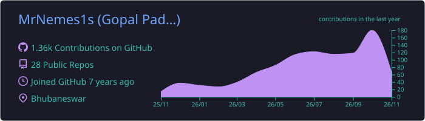
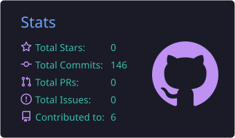
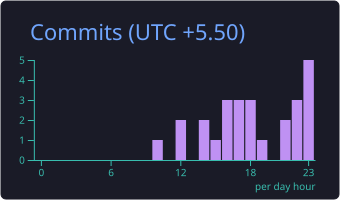
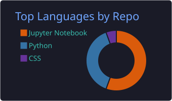
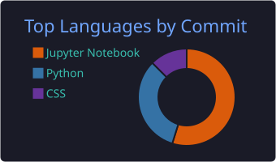

<!-- ===================== HEADER ===================== -->
<p align="center">
  
</p>

<p align="center">
  <a href="https://github.com/MrNemes1s">
    
  </a>
</p>

<p align="center">
  
  
  
</p>

---

##  About me

<table>
<tr>
<td width="58%">

```python
class Gopal:
    role      = "Lead AI Engineer @ Golgix AI"
    founder   = "Revonex — AI products & consulting"
    location  = "Bhubaneswar, Odisha, India"
    exp_years = 10

    focus = [
        "Agentic AI systems",
        "RAG pipelines & knowledge graphs",
        "LLM apps that survive production",
    ]

    previously = ["Lead ML Engineer @ FIS",
                  "Senior Software Developer (ML) @ TIAA"]

    def motto(self):
        return "Let the agent do the boring job."
```

</td>
<td width="42%" align="center">
  
</td>
</tr>
</table>

- 🔭 Building **agentic AI systems** that reason over real industrial data
- 🧠 Exploring **knowledge graphs + LLMs**, fine-tuning VLMs, and long-term agent memory
- 🎥 Starting a YouTube channel with long-form **AI explainers**
- 💬 Ask me about **RAG, LlamaIndex, FastAPI, multi-agent workflows**

---

## 🛠️ Tech stack

<p align="center">
  
  <br/>
  
  <br/>
  
</p>

<p align="center">
  
  
  
  
  
  
  
  
</p>

---

## 🚀 Featured projects

<table>
<tr>
<td width="50%" valign="top">

### 📊 [PulseUltra](https://github.com/MrNemes1s/PulseUltra)
An AI agent that does **end-to-end EDA**: writes Python, runs it, fixes its own errors, reads the output and answers your questions.

`Agents` `Code execution` `Self-healing`

</td>
<td width="50%" valign="top">

### 🧑‍💼 [Elom-Nusk-Agent](https://github.com/MrNemes1s/Elom-Nusk-Agent)
An **AI Scrum Master**. Let it do the boring job: stand-ups, ticket grooming, follow-ups.

`Multi-agent` `Python` `Productivity`

</td>
</tr>
<tr>
<td width="50%" valign="top">

### 📬 [powermail](https://github.com/MrNemes1s/powermail)
An agent that reads your inbox and sends you a **morning summary** of what matters.

`LLM` `Email` `Automation`

</td>
<td width="50%" valign="top">

### 🏢 [EMS](https://github.com/MrNemes1s/EMS)
AI-powered **Employee Management System** with a built-in Copilot.

`Copilot` `FastAPI` `RAG`

</td>
</tr>
<tr>
<td width="50%" valign="top">

### 🔨 [VaultForge](https://github.com/MrNemes1s/VaultForge)
Tooling for an AI-maintained **personal knowledge graph** on top of Markdown notes.

`Knowledge graph` `Obsidian` `Python`

</td>
<td width="50%" valign="top">

### 👁️ [Finetuning_vlms](https://github.com/MrNemes1s/Finetuning_vlms)
Experiments in **fine-tuning vision-language models**.

`VLM` `Fine-tuning` `PyTorch`

</td>
</tr>
</table>

---

## 📈 GitHub stats

<p align="center">
  
</p>

<p align="center">
  
  
</p>

<p align="center">
  
  
</p>

---

## 🐍 Contribution snake

<p align="center">
  <picture>
    <source media="(prefers-color-scheme: dark)" srcset="https://raw.githubusercontent.com/MrNemes1s/MrNemes1s/output/github-contribution-grid-snake-dark.svg" />
    <source media="(prefers-color-scheme: light)" srcset="https://raw.githubusercontent.com/MrNemes1s/MrNemes1s/output/github-contribution-grid-snake.svg" />
    
  </picture>
</p>

---

## 🤝 Let's connect

<p align="center">
  <a href="https://github.com/MrNemes1s"></a>
  <a href="https://www.linkedin.com/in/YOUR_LINKEDIN"></a>
  <a href="https://www.youtube.com/@YOUR_CHANNEL"></a>
  <a href="mailto:YOUR_EMAIL"></a>
</p>

<!-- ===================== FOOTER ===================== -->
<p align="center">
  
</p>
